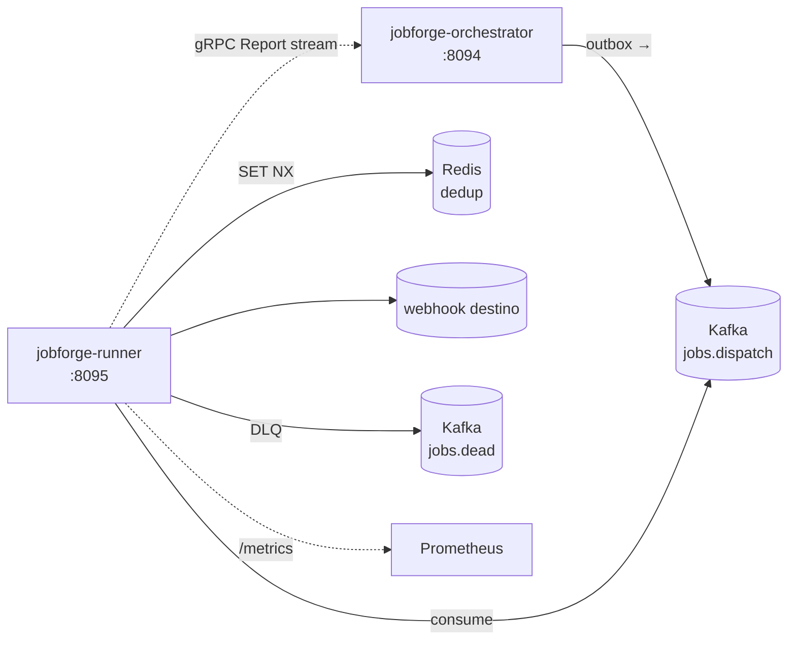

# jobforge-runner

[](https://github.com/TiagoR85/jobforge-runner/actions/workflows/ci.yml)
[](https://github.com/TiagoR85/jobforge-runner/releases)
[](LICENSE)

Runner of the jobforge family: a Kafka consumer that executes webhooks with Redis dedup (exactly-once-effectively), classifies responses (4xx permanent vs 5xx/timeout retryable), retries inline with exponential backoff, dead-letters exhausted/permanent executions, and reports every state transition to the orchestrator over a persistent gRPC stream.



## Status

Second of the three jobforge repositories. `jobforge-orchestrator` v1.0.0 is shipped; this runner consumes its `jobs.dispatch` topic and speaks its `status.proto` contract (fetched by tag via `scripts/fetch-proto.ps1`). `jobforge-ui` (Blazor console + hub compose) follows next.

## Running tests

Tests use Testcontainers (Kafka + Redis) — Docker must be running. The proto is committed; the fetch script refreshes it when the orchestrator tag changes.

```powershell
pwsh ./scripts/fetch-proto.ps1 -Ref v1.0.0   # refresh contract (CI runs this pre-restore)
dotnet test tests/JobForge.Runner.Tests -p:CollectCoverage=false   # fast loop
dotnet test tests/JobForge.Runner.Tests                            # CI gate (coverage ≥80%)
```

## Endpoints

| Endpoint | Notes |
|---|---|
| `/health/live` | self |
| `/health/ready` | Redis + Kafka metadata |
| `/metrics` | Prometheus (`jobforge_runner_attempts_total`, `jobforge_webhook_duration_seconds`, `jobforge_dlq_published_total`) |

Required configuration (fail-fast): `ConnectionStrings:Redis`, `Kafka:BootstrapServers`, `Orchestrator:GrpcUrl`. See `appsettings.Development.json` for local defaults.

## Processing flow

1. Consume `jobs.dispatch` (group `jobs.runners`, manual commit).
2. `DispatchEnvelope.TryParse` — bad JSON → log + commit (skip).
3. Redis dedup `SET NX runner:exec:{executionId} EX 3600` — duplicate → commit + skip.
4. gRPC `running` report → webhook execute → classify.
5. Succeeded → `succeeded` report + commit. Permanent 4xx → DLQ + `dead` report + commit. Retryable → `failed` report + backoff `2^(attempt-1)`s (cap 30s) → retry inline; exhausted → DLQ + `dead` + commit.

## Decisions

- [ADR-0001](docs/adr/ADR-0001-inline-retry.md) — inline retry loop with exponential backoff; no retry-topics
- [ADR-0002](docs/adr/ADR-0002-redis-dedup.md) — Redis SET NX as exactly-once-effective guard
- [ADR-0003](docs/adr/ADR-0003-response-classification.md) — 4xx permanent (except 408/429), 5xx/timeout retryable
- [ADR-0004](docs/adr/ADR-0004-reconstructable-status-stream.md) — Postgres state derived from the gRPC stream; reconnect + requeue

## Roadmap

Implemented: Kafka consumer · Redis dedup · webhook executor + classification · inline retry/backoff · DLQ publish · gRPC status stream (reconnect + requeue) · health checks + Prometheus + JSON logs.

Out of scope for this release (backlog): DLQ replay CLI · retry-topics migration path · mTLS on the gRPC stream · per-attempt metrics granularity · OpenTelemetry traces · compose profiles for a VPS.

## About this repository

This repository is part of a personal study project (the "github-portfolio-dotnet" portfolio). It was built with heavy use of AI-assisted development tools, but it is held to production standards on purpose: automated tests with a coverage gate, CI on every push, fail-fast configuration, structured logging, and honest documentation of trade-offs. It is not affiliated with any employer or client.

## License

MIT — see [LICENSE](LICENSE).
